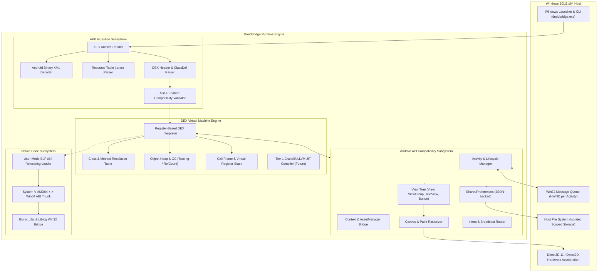
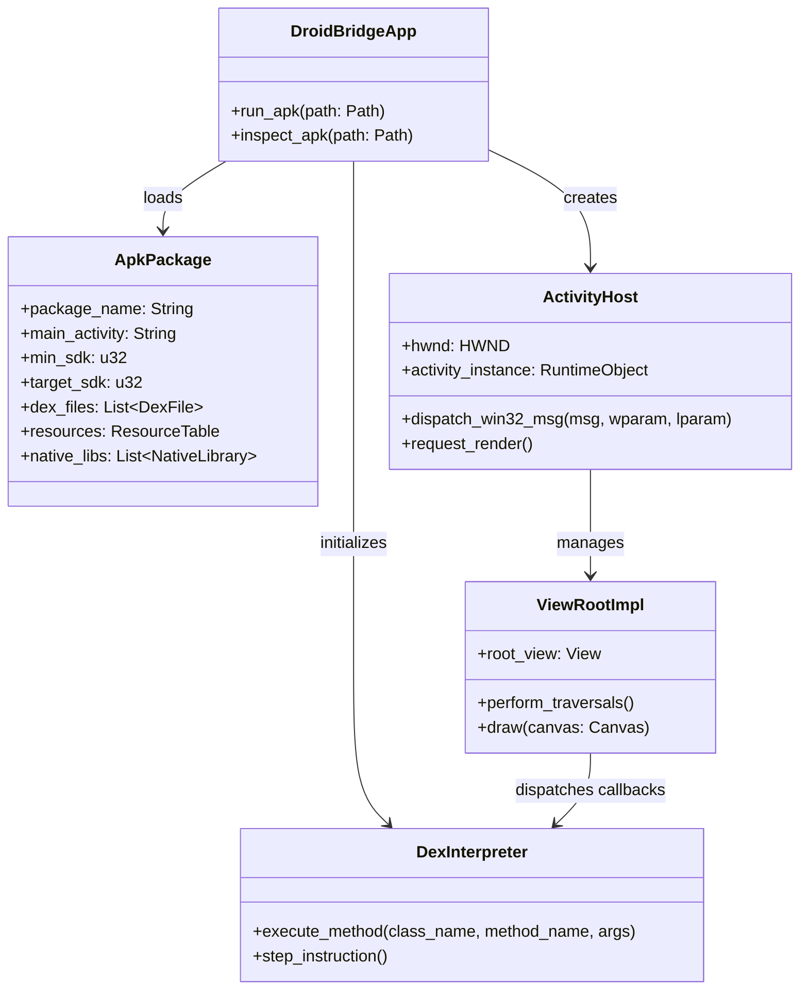

# DroidBridge: System Architecture Specification

## 1. Architectural Principles

DroidBridge is architected around five fundamental principles:
1. **Host-Native Execution:** No hypervisor, no virtual machine monitor (VMM), no guest operating system kernel.
2. **Memory Safety by Construction:** Core parsing (APK, Binary XML, DEX, ARSC) and low-level bytecode dispatch are implemented in **Rust** to eliminate memory corruption vulnerabilities from untrusted APK input.
3. **High-Performance Native Graphics:** Windowing, swap chain management, and low-level rendering leverage **C++20** and modern Windows APIs (Direct3D 11 / Direct2D / Win32).
4. **Modular Subsystems:** Clean boundaries between APK loading, bytecode execution, framework emulation, and platform rendering.
5. **Fail-Safe Degradation:** Unimplemented Android APIs gracefully log diagnostic telemetry and return safe sentinel values rather than crashing the runtime.

---

## 2. High-Level System Architecture

---

## 3. Subsystem Detailed Specifications

### 3.1 Module 1: APK Ingestion Subsystem (`droidbridge_loader`)
Responsible for reading arbitrary `.apk` packages, inspecting their digital signatures, validating structural integrity, and parsing the manifest and resources.

- **`ZipArchive`**: Pure Rust ZIP reader reading central directory headers, local file headers, and compressed streams with decompression support (Deflate, Stored).
- **`AxmlDecoder`**: Decodes Android Binary XML format:
  - Header validation (`RES_XML_TYPE = 0x0003`).
  - String pool extraction (UTF-8 / UTF-16 string tables and style spans).
  - Resource ID map resolution (`RES_XML_RESOURCE_MAP_TYPE = 0x0180`).
  - Hierarchical node traversal: `START_NAMESPACE`, `END_NAMESPACE`, `START_TAG`, `END_TAG`, `TEXT`.
  - Manifest attribute extraction: package name, versionCode, versionName, minSdkVersion, targetSdkVersion, declared permissions, application classes, and activities with intent-filters.
- **`DexParser`**:
  - Validates DEX magic (`dex\n035\0`, `dex\n037\0`, `dex\n038\0`, `dex\n039\0`).
  - Parses header fields: checksum (Adler32), signature (SHA-1), string_ids, type_ids, proto_ids, field_ids, method_ids, class_defs, data section.
  - Extracts `EncodedMethod` items, code offsets, register counts, input argument counts, and bytecode instruction streams.
- **`FeatureCompatibilityValidator`**:
  - Analyzes permissions (`android.permission.INTERNET`, etc.).
  - Inspects `lib/` directory: checks whether only ARM/ARM64 libraries exist, or if x86_64 binaries are available.
  - Emits clear, deterministic compatibility verdicts:
    - `SupportedPureManaged`: 100% DEX bytecode, no native libraries.
    - `SupportedWithNativeX64`: Contains x86_64 ELF libraries supported via user-mode ELF loader.
    - `BlockedArmOnlyNative`: Contains only ARM/ARM64 `.so` libraries requiring instruction translation.
    - `UnsupportedFeature`: Relies on unsupported hardware requirements (e.g. specialized sensors, telephony).

---

### 3.2 Module 2: DEX Execution Engine (`droidbridge_core`)
A clean-room register-based virtual execution engine designed to execute Dalvik bytecode on host Windows threads.

- **Virtual Register Model:**
  - Dalvik instructions operate on virtual registers designated `v0` to `vN`, with method parameters mapped to the upper registers `v(N-M)` to `vN` (also referenced as `p0` to `pM`).
  - Each call frame maintains an array of `Value` cells (supporting 32-bit integer/float, 64-bit wide long/double occupying register pairs `(vX, vX+1)`, and reference pointers to heap-allocated objects).
- **Core Opcode Dispatch:**
  - Fast, modular `match` dispatch over decoded Dalvik instructions.
  - Implements:
    - Constants: `const/4`, `const/16`, `const`, `const-high16`, `const-wide`, `const-string`.
    - Moves: `move`, `move/from16`, `move-wide`, `move-object`.
    - Returns: `return-void`, `return`, `return-wide`, `return-object`.
    - Arithmetic & Logic: `add-int`, `sub-int`, `mul-int`, `div-int`, `and-int`, `or-int`, `xor-int`, plus 2-address variants (`add-int/2addr`) and literal variants (`add-int/lit8`, `add-int/lit16`).
    - Comparison & Branching: `goto`, `if-eq`, `if-ne`, `if-lt`, `if-ge`, `if-gt`, `if-le`, `if-eqz`, `if-nez`.
    - Invocation: `invoke-virtual`, `invoke-direct`, `invoke-static`, `invoke-interface`.
    - Object Lifecycle: `new-instance`, `iget`, `iput`, `sget`, `sput`, `new-array`, `array-length`.
- **Heap & Garbage Collection:**
  - Managed heap storing `RuntimeObject` (class descriptor, field table) and `RuntimeArray` (element type, length, contiguous buffer).
  - Generation-based or reference-counted ownership with cycle collection for host-bound objects.

---

### 3.3 Module 3: Android API Compatibility Layer (`droidbridge_framework`)
Implements the core subset of the Android SDK required to start an application and display interactive UI:

- **`android.content.Context`:**
  - Provides package information, access to assets (`getAssets()`), resources (`getResources()`), and file directories (`getFilesDir()`, `getCacheDir()`).
  - Isolates filesystem access to `%LOCALAPPDATA%\DroidBridge\Data\<package_name>\`.
- **`android.app.Activity`:**
  - Manages the lifecycle state machine:
    $$\text{INITIALIZED} \longrightarrow \text{CREATED} \longrightarrow \text{STARTED} \longrightarrow \text{RESUMED} \longleftrightarrow \text{PAUSED} \longrightarrow \text{STOPPED} \longrightarrow \text{DESTROYED}$$
  - Handles `setContentView(View)` and connects the activity view root to the window renderer.
- **`android.view.View` & `android.view.ViewGroup`:**
  - Node in the UI hierarchy.
  - Implements layout pass: `measure(widthSpec, heightSpec)` and `layout(l, t, r, b)`.
  - Implements event dispatch: `dispatchTouchEvent(MotionEvent)`, `dispatchKeyEvent(KeyEvent)`.
- **`android.widget.*`:**
  - `TextView`: Text layout, font metrics, text rendering.
  - `Button`: Focus states, click listeners, visual feedback.
  - `LinearLayout` / `FrameLayout`: Basic layout containers.

---

### 3.4 Module 4: Graphics & Windowing Subsystem (`droidbridge_graphics`)
Maps the Android rendering pipeline directly onto Windows desktop infrastructure:

- **Window Management:**
  - Registers a Win32 window class (`DroidBridgeActivityWindowClass`).
  - Instantiates a standard top-level Win32 window (`HWND`) configured with `WS_OVERLAPPEDWINDOW`.
  - Configures window title to match `android:label` and window icon to match `android:icon`.
- **Rendering Pipeline:**
  - Creates a Direct3D 11 device and `IDXGISwapChain`.
  - Alternatively, creates a native software/hardware rasterizer via Skia or Direct2D targeting the swap chain back buffer.
  - When an Android View calls `invalidate()`, a paint request is scheduled and flushed on the next `WM_PAINT` message.
- **Input Pipeline:**
  - Traps `WM_MOUSEMOVE`, `WM_LBUTTONDOWN`, `WM_LBUTTONUP`.
  - Translates Win32 coordinates $(x, y)$ to normalized density-independent pixels (dp) based on configured DPI scale.
  - Emits `MotionEvent` into the active Activity's `dispatchTouchEvent()`.

---

## 4. Component Dependency & Boundary Model

